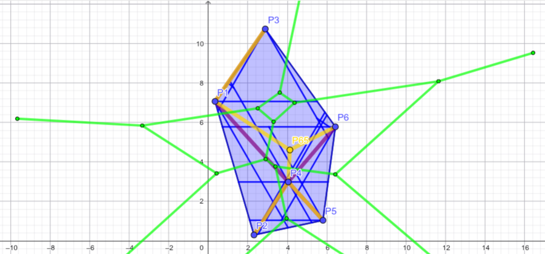

# Order-k Voronoi Diagram

Given a set **P** of n points in the plane (the *sites*) and an integer k with
1 ≤ k < n, the **order-k Voronoi diagram** divides the plane into regions in which
every point has the same k nearest sites. For k = 1 it is the ordinary Voronoi
diagram; for k = n − 1 it is the farthest-point Voronoi diagram.

This program computes the order-k Voronoi diagram with CGAL, and writes it as JSON
on stdout, clipped to a box around the sites. The construction and much of the
code come from CGAL's `multi_delaunay` ipelet demo (see [Attribution](#attribution)).
I wrote it during my PhD as a companion to
[OneSteinerTreeProblem](https://github.com/anthonydangelo/OneSteinerTreeProblem):
the interactive web page that drew 1-Steiner trees could also draw the order-k
Voronoi diagram of the same sites, so that I could look for relations between
optimal Steiner points and the order-k Voronoi regions.



*Six sites (P1–P6) with their order-2 Voronoi diagram (green) from this program,
drawn by the web page over the arrangement and trees from OneSteinerTreeProblem.
Made with [GeoGebra®](https://www.geogebra.org) (© GeoGebra GmbH).*

**Version 2.0** came from testing the program against a brute-force computation
and measuring it:

- The diagram is now computed exactly: the demo computed its weighted points in
  double precision, which could split a degenerate vertex into several (see
  [Exactness](#exactness)).
- Repeated input points no longer give a wrong diagram, coordinates are
  printed with 17 significant digits instead of 6, 
  and output vertices are matched exactly.
- Measured limits on a 4-CPU virtual machine: any order for up to 24 sites within
  10 minutes and 2 GB; orders 1, 2, 3 and n − 1 in under a second even for 100
  sites; and a formula for the rest (see
  [Performance and limits](#performance-and-limits)).

**Quick start** (Linux, with CGAL 4.11.2 built; see [Build](#build)):

```bash
make CGAL_DIR=/path/to/CGAL-4.11.2
./OrderKVoronoiD -i "[[0,0],[4,1],[1,5],[6,6],[3,3],[7,2]]" -o 2
```

Orders 1, 2, 3 and n − 1 run in under a second even for 100 sites, but other
orders get very expensive in both time and memory as the number of sites grows
(see [Performance and limits](#performance-and-limits)), and the program does not
stop a run that would take hours or use up all the memory. For larger inputs,
limit both, e.g. to 10 minutes and about 2 GB:

```bash
(ulimit -v 2000000; timeout 10m ./OrderKVoronoiD -i "[[...]]" -o 8)
```

See [Usage](#usage) for the options and the output format,
[Testing and tools](#testing-and-tools) for the tests, and
[Performance and limits](#performance-and-limits) for what size of input to
expect to run.

## Context

I wrote this program in 2018, during my PhD, for the same experiments as
[OneSteinerTreeProblem](https://github.com/anthonydangelo/OneSteinerTreeProblem),
an implementation of the Georgakopoulos–Papadimitriou 1-Steiner tree algorithm.
An interactive web page (JavaScript and GeoGebra) let me place sites; the server
ran OneSteinerTreeProblem and drew the 1-Steiner tree, and could also run this
program and draw the order-k Voronoi diagram of the same sites, as in the picture
above. The aim was to analyze optimal Steiner points in the context of the
Voronoi structure: for example, where the Steiner point falls relative to the
order-k regions. Both programs are computationally intensive, so they share a
lock that lets only one of them compute at a time (see [Usage](#usage)).

The web page is currently offline.

**Reference:** Georgakopoulos & Papadimitriou (1987). The 1-Steiner Tree Problem.
*Journal of Algorithms*, 8(1), 122–130.

### What this project contributes

- A standalone command-line program (C++11, CGAL 4.11.2) that wraps the order-k
  Delaunay/Voronoi construction from CGAL's `multi_delaunay` ipelet demo, with
  JSON output for a web page or other programs.
- Exact computation: the weighted points are exact rationals instead of the
  demo's doubles, with each one's exact value stored compactly (see
  [Exactness](#exactness)).
- Fixes found by testing (including a brute-force check) and code review:
  repeated input points, the output's precision, and how output vertices are
  matched.
- Test inputs covering every code path, a brute-force checker for the output, a
  sanitizer build, and measured time and memory limits with a formula for
  estimating others (see [Testing and tools](#testing-and-tools) and
  [Performance and limits](#performance-and-limits)).

## Algorithm

The method is CGAL's, from its `multi_delaunay` ipelet demo (see
[Attribution](#attribution)); this program uses it as it is, apart from the
changes described in [Exactness](#exactness).

1. **Input:** at least 2 sites, and the order k (1 ≤ k < n). Repeated sites are
   removed first, with a warning.
2. **Weighted points.** For each group of k sites, the program makes a *weighted
   point*: a point at the group's centre (the average of its sites), with a weight
   that depends on how spread out the group is. Each weighted point has a
   *weighted distance* to any location: the squared distance from the location to
   the point, minus the point's weight. At each location, the weighted point with
   the smallest weighted distance *wins*. The weights are chosen so that the
   weighted distance equals the group's average squared distance to the location,
   so the winner is always the group of the k sites nearest to that location.
   Where two or more groups tie, the location lies on the boundary between their
   regions: on an edge of the diagram, or at a vertex.
3. **Regular triangulation.** CGAL triangulates the weighted points: a *regular
   triangulation* is the version of the Delaunay triangulation for weighted
   points. Groups that win nowhere do not appear in it.
4. **Output:** the regions won by each remaining weighted point form the order-k
   Voronoi diagram. Its edges (segments, rays and lines) are clipped to the sites'
   bounding box, enlarged by 10 units on each side, and written as JSON.

**Which groups get a weighted point.** Using every group of k sites always works,
but the number of groups, C(n, k), grows very quickly, so some orders have faster
paths:

| Order | Groups used |
|---|---|
| k = 1 | none: the ordinary Voronoi diagram, from the Delaunay triangulation of the sites |
| k = 2 | only pairs of sites that are neighbours in the Delaunay triangulation (at most 3n − 6 pairs) |
| k = 3 | triples chosen from the k = 2 result, by the CGAL demo's rule |
| k = n − 1 | each site left out in turn, n groups: the farthest-point Voronoi diagram, with the sums behind the weights computed once and shared |
| any other k | every group of k sites, C(n, k) of them |

The last row is what limits this program. The order-k Voronoi diagram has only
O(k(n − k)) regions (Lee 1982), but the program makes a weighted point for every
group, and nearly all of them win nowhere. See
[Performance and limits](#performance-and-limits) for what that costs, and
[Limitations and future work](#limitations-and-future-work) for faster
algorithms.

This program's brute-force check (see [Testing and tools](#testing-and-tools))
compares the output with the k nearest sites computed directly, and agrees on
every test input, for every path.

**To learn more:** Aurenhammer, Klein, and Lee's book covers order-k Voronoi
diagrams and the diagrams of weighted points behind regular triangulations
(*power diagrams*), and CGAL's
[2D Triangulation manual](https://doc.cgal.org/4.11.2/Triangulation_2/index.html)
describes regular triangulations.

**References**

- Aurenhammer, Klein, & Lee (2013). *Voronoi Diagrams and Delaunay
  Triangulations*. World Scientific.
- Lee (1982). On k-Nearest Neighbor Voronoi Diagrams in the Plane. *IEEE
  Transactions on Computers*, 31(6), 478–487.

## Exactness

The program computes with exact numbers: every point and weight it constructs is
the exact value, not a rounded one, and every geometric test (which side of a
line a point lies on, which weighted point wins) gives the true answer. Rounded
floating-point arithmetic can get such tests wrong when values tie, which in
geometric code leads to wrong structures or crashes. Exact arithmetic is possible
here because every input is a double, which is itself an exact fraction (0.1, as
a double, is exactly 3602879701896397 / 2⁵⁵), and the program only ever adds,
subtracts, multiplies and divides: no square roots. So every value it computes is
a fraction too, and can be stored exactly.

The number type is CGAL's `Lazy_exact_nt<Gmpq>`: exact fractions (GMP's
rationals), which first compute with fast interval approximations and compute the
exact value only when the approximation cannot decide a test.

There is one exception in the output:

- **The output prints doubles,** with 17 significant digits. 
  The program computes every vertex exactly, as a fraction, and prints each 
  coordinate as a double within one unit in the last place of the exact value 
  (a double can only hold fractions whose denominator is a power of 2, 
  such as 3/4, so most vertices are rounded).

### From the demo's doubles to exact rationals

The CGAL demo computed each weighted point's centre and weight in double
precision, then passed them to the exact code. Where several regions should meet
at one vertex, the rounded weights could make them meet at several nearby
vertices instead, joined by tiny edges. The brute-force check found such a case:
12 sites at k = 6 gave 5 edges of zero length, at two points where four sites are
exactly equidistant. Computing the weights exactly fixed it.

But it made the program use far more memory, about 20 KB per group instead of
0.3 KB, and 20 sites at k = 10 no longer fit in 3.8 GB of RAM. The number
type then was `Lazy_exact_nt<CORE::Expr>`. A lazy number does not compute its
exact value until it is needed; instead it keeps a record of how it was computed,
and each weight involves a few hundred operations, so every group kept a record
of all of them. Two changes fixed it:

- **Rationals instead of `CORE::Expr`.** `CORE::Expr` can represent square roots,
  which this program never needs, and its exact values are themselves records of
  operations. GMP rationals are plain fractions.
- **Computing each group's exact values at once** (`.exact()` in `k_delaunay.h`),
  which replaces the record with a single fraction.

Memory went down to about 0.75 KB per group. Exactness still costs something:
compared with the demo's doubles, the general path takes about 4 to 5 times as
long and 2.5 times as much memory (20 sites, k = 8 to 12). The numbers for larger
inputs are in [Performance and limits](#performance-and-limits).

## Performance and limits

The program has no limit on the number of sites or the order, so it is up to the
user to choose inputs that fit their time and memory. These measurements are a
guide.

**Measured** on a VirtualBox virtual machine (Ubuntu 16.04, 4 CPUs, 3.8 GiB of
RAM; the program is single-threaded), release build, run from a text console,
with random sites at integer coordinates in [−500, 500] (`tests/time-orders.sh`;
see [Testing and tools](#testing-and-tools)):

| Sites | Orders | Time | Peak memory |
|---|---|---|---|
| 10 | all | at most 0.03 s | at most 6 MB |
| 20 | all | at most 23 s (k = 11) | at most 137 MB (k = 10) |
| 24 | k = 12, 13, 14 (the slowest) | 444 s, 462 s, 411 s | 2.0 GB, 1.8 GB, 1.4 GB |
| 26 | k = 13 | stopped after 10 minutes | 2.4 GB at that point |
| 100 | k = 1, 2, 3, 99 | at most 0.08 s | at most 9 MB |
| 16 | k = 8 | 1.3 s | 11 MB |
| 40 | k = 5 | 36 s | 487 MB |
| 60 | k = 57 | 141 s | 27 MB |
| 100 | k = 98 | 60 s | 7 MB |

In short, on this machine:

- **up to 24 sites, any order** runs within 10 minutes and 2 GB;
- **orders 1, 2, 3 and n − 1** take well under a second, even for 100 sites;
- **any other order** costs time and memory in proportion to the number of groups
  of k sites, C(n, k), which grows very fast towards k = n/2.

**Estimating other inputs.** For orders 4 to n − 2, with G = C(n, k) groups:

- time ≈ G × (17 + 0.38·n + 1.09·k(k − 1)) microseconds;
- peak memory ≈ G × 0.75 KB + 2 MB.

Each group's weight sums over all pairs of its k sites, hence the k(k − 1) term,
and inserting its weighted point costs more as the number of sites grows, hence
the n term. Because of the k(k − 1) term, the slowest order is a little above
n/2 (k = 13 for 24 sites), while memory peaks at k = n/2. These formulas fit all
14 timing runs above within 15%, and all the memory measurements within 3%. They
estimate, for example, that 25 sites exceed 10 minutes for orders 10 to 15, 40
sites for orders 6 to 35, and 100 sites for orders 4 to 97 (but 100 sites at
k = 98 takes a minute).

**Beyond these measurements, you're on your own.** They were made on one machine,
with random inputs. The formulas held for every order up to 24 sites, for
orders 1, 2, 3 and n − 1 up to 100 sites, and for the few larger cases in the
table; anything else is an estimate. Degenerate inputs (grids, many points on a
circle) need more exact computation and can be slower.
Other machines will
differ: to scale the estimates, time `tests/time-orders.sh ./OrderKVoronoiD 16 8`
on your machine and compare with the 1.3 s above.
The program does not stop a run that would take hours or use up all the memory;
limit both, as in the [quick start](#order-k-voronoi-diagram) (with a memory
limit, the program stops with `ERROR: std::bad_alloc` and exit code 1).

## Build

### Dependencies

- g++ with C++11 support
- CGAL 4.11.2, including its compiled library (`libCGAL`); see CGAL's
  [installation manual](https://doc.cgal.org/4.11.2/Manual/installation.html)
- Boost (thread, system), GMP and MPFR, as required by CGAL

**Tested with:** Ubuntu 16.04.7 LTS, g++ 5.4.0, CGAL 4.11.2, Boost 1.58,
GMP 6.1.0, MPFR 3.1.4.

The code is C++11 and was written in 2018 for CGAL 4.11.2 and g++ 5.4 on
Ubuntu 16.04, the same toolchain as
[OneSteinerTreeProblem](https://github.com/anthonydangelo/OneSteinerTreeProblem).
Porting to a current CGAL is future work: CGAL 5.0 and later require C++14 and
g++ 6.3 or newer.

### Set `CGAL_DIR`

The Makefile looks for the CGAL library in `$CGAL_DIR/lib`, so set `CGAL_DIR` to
your CGAL 4.11.2 build directory. For example, add this line to `~/.profile`,
then log out and back in:

```bash
export CGAL_DIR=/path/to/CGAL-4.11.2
```

Or give it on the command line: `make CGAL_DIR=/path/to/CGAL-4.11.2`. If it is
not set, `make` stops with a message saying so.

The repository includes VS Code build tasks (`build-release`, `build-debug`,
`build-asan` in `.vscode/tasks.json`) that run `make`. VS Code must be started
with `CGAL_DIR` in its environment: `~/.profile` covers VS Code started from the
desktop; if you set it only in `~/.bashrc`, start VS Code from a terminal
(`code .`).

### Compile

| Command | Binary | Purpose |
|---|---|---|
| `make` or `make release` | `OrderKVoronoiD` | optimized build |
| `make debug` | `OrderKVoronoiD_d` | debug build |
| `make asan` | `OrderKVoronoiD-asan` | AddressSanitizer and UndefinedBehaviorSanitizer build |
| `make variants` | all of the above | builds every binary |
| `make clean` | | deletes the binaries |

All builds except `asan` are statically linked, so the binaries run on other
x86-64 Linux systems without CGAL, Boost, GMP or MPFR installed. Extra compiler
flags go in `EXTRA_FLAGS`, e.g. `make release EXTRA_FLAGS=-DNDEBUG`. Because
`make` does not track flags, use `make -B` to force a rebuild after changing
them.

## Usage

```bash
./OrderKVoronoiD -i "[[1,0],[2,0],[3,0],[1,2],[2,2]]"         # ordinary Voronoi diagram (k = 1)
./OrderKVoronoiD -i "[[1,0],[2,0],[3,0],[1,2],[2,2]]" -o 2    # order 2
./OrderKVoronoiD --help
```

| Option | Description |
|---|---|
| `-i`, `--input-list "[[x,y],...]"` | The sites, as a JSON-style list of pairs (in quotes). At least 2 distinct sites. |
| `-o`, `--order <int>` | The order k, from 1 to n − 1 (default 1). |
| `--no-mutex` | Don't take the lock (see below). |
| `-h`, `--help` | Show the help. |

The JSON goes to stdout. The help (`-h`) also goes to stdout; errors and
warnings go to stderr. A site given more than once is used once, with a warning;
the order is then checked against the number of distinct sites. An invalid value
for `-o` (not a positive integer) prints a warning and uses the default, 1. A
missing or malformed `-i` list, an order of n or more, or an unknown option
prints the help on stderr and exits with 1. The program also exits with 1 if
writing the output fails (for example, on a full disk) or if it runs out of
memory, and with 0 otherwise.

### Output format

```json
{
"order": "2",
"voronoiDiagram": {
    "voronoiPoints": [
        {"x":"1.5", "y":"0"},
        ...
    ],
    "voronoiEdgesPtIndices": [
        {"voronoiEdge":{"firstIndex":"0", "secondIndex":"1"}},
        ...
    ]
},
"elapsedTime" : {"s":"0", "m":"0", "h":"0"}
}
```

- All values are JSON strings. Coordinates are printed with 17 significant
  digits, from the exact values: each is within one unit in the last place of
  the exact coordinate (see [Exactness](#exactness)).  
- `voronoiPoints` are the endpoints of the diagram's edges, after clipping to the
  bounding box, and each edge in `voronoiEdgesPtIndices` refers to two of them by
  their position in the list, counting from 0. Rays and lines are clipped to
  segments whose outer endpoints lie on the box.
- The output lists edges only, not regions, and does not say which group of k
  sites each region belongs to.
- `elapsedTime` is the computation time in whole seconds, not including writing
  the output.

### The lock

Both this program and
[OneSteinerTreeProblem](https://github.com/anthonydangelo/OneSteinerTreeProblem)
are computationally intensive, and the website was not expected to handle
significant traffic. To keep the server from being overwhelmed by concurrent
requests (legitimate or not), the program takes a blocking `flock` on
`/tmp/one-st-tree-mutex.lock` before doing any work. This is the same lock file
that OneSteinerTreeProblem uses, so at most one run of either program computes at
a time; other runs wait, without a message.

The lock can be turned off with `--no-mutex`, so that the caller (e.g., the
website's server code) manages concurrent runs itself. Stopping a run is possible
either way (with `timeout` or by killing it, which also releases the lock), but a
caller that takes its own lock before starting the program can do two things the
program's lock cannot: turn a request away at once when another run is busy,
instead of making it wait silently, and apply a time limit to the computation
alone (with the program's lock, a run that waits for the lock is still counting
down its time limit while it waits). On a machine shared by several users, the
first user's run creates the lock file readable and writable only by that user,
so other users' runs cannot open it and need `--no-mutex`.

## Testing and tools

The test scripts are in `tests/` (bash, and Python 3.5 or later); each prints its
usage when run without arguments.

### Test cases

`tests/cases.txt` has 30 cases, one per line: a name, a description, and the
program's arguments.

| Cases | What they cover |
|---|---|
| 6 random sites, k = 1 to 5 | every code path: k = 1, the k = 2 and k = 3 paths, general k, and k = n − 1 |
| 12 random sites, k = 4, 6, 11 | general k with hundreds of groups, and k = n − 1 |
| 2 to 4 sites | the smallest inputs, where paths coincide (e.g. 3 sites at k = 2 is also k = n − 1) |
| degenerate inputs | a square, a 3 × 3 grid, collinear sites, two sites 10⁻⁷ apart, and a repeated site (at k = 2 and k = 4) |
| errors and options | an order too large, a single site, a malformed list, no list, a repeat that leaves too few sites; `-h`; invalid `-o` values |

```bash
tests/run-cases.sh run ./OrderKVoronoiD before        # run every case, save the outputs as "before"
tests/run-cases.sh run ./OrderKVoronoiD after         # (after a change and a rebuild)
tests/run-cases.sh compare before after               # compare the two runs
python3 tests/check-diagram.py after                  # check each diagram against brute force
```

`run-cases.sh run` saves each case's output, stderr and exit code under
`tests/out/<label>/`. `compare` checks two runs case by case (exit code, output
and stderr), ignoring `elapsedTime`.

`check-diagram.py` checks each output diagram against the k nearest sites,
computed directly. Every point of an edge is a place where the set of k nearest
sites changes, so the k-th and (k + 1)-th nearest sites are equally far away
there; the checker tests this at one point on each edge, its midpoint, to catch
an edge in the wrong place. It also lays a fine grid of sample points over the
diagram, and wherever two neighbouring samples have different sets of k nearest
sites, it checks that an output edge lies between them, to catch a missing edge.
Finally, it checks that no edge has zero length or appears twice. The output's
coordinates are doubles, so the checks allow a small tolerance.
All 21 cases that
produce a diagram pass. (It found two of the problems fixed in version 2.0: the repeated
site, and the zero-length edges described in [Exactness](#exactness).)

### Sanitizers

`make asan` builds with AddressSanitizer, LeakSanitizer and
UndefinedBehaviorSanitizer. All the test cases run clean under it, and give the
same output as the release build: no memory errors, no leaks, and no undefined
behaviour in this program's code. UBSan's `vptr` check is turned off, because
CGAL's data structures cast their internal records to derived classes, which the
check would report on every run; one other UBSan report comes from inside CGAL
4.11.2 and is documented in the Makefile. To compare a sanitizer run with a
release run:

```bash
tests/run-cases.sh run ./OrderKVoronoiD-asan asan
IGNORE_STDERR=1 tests/run-cases.sh compare before asan   # the sanitizers write to stderr
tests/run-cases.sh sanitizers asan                       # list any sanitizer reports
```

### Determinism

`tests/check-determinism.sh` runs every case that produces a diagram 50 times,
and 50 more times with address-space randomisation turned off, and checks that
the outputs are identical (apart from `elapsedTime`). Memory addresses change
from run to run, so output that depended on them would show up here. All 21
cases give identical output in all 100 runs.

```bash
tests/check-determinism.sh ./OrderKVoronoiD
```

### Static analysis

cppcheck 1.72 (with its warning, style, performance and portability checks)
reports no issues in `src/`.

### Timing

`tests/time-orders.sh` times one random input at several orders, which is how the
numbers in [Performance and limits](#performance-and-limits) were measured:

```bash
tests/time-orders.sh ./OrderKVoronoiD 10                  # 10 random sites, every order
CASE_TIMEOUT=10m tests/time-orders.sh ./OrderKVoronoiD 24 12 13   # 24 sites, two orders, 10 minutes each at most
```

It reports each run's time and peak memory (from GNU `time`), logs memory
activity with `vmstat` while it runs, and reports at the end whether the system
swapped. The sites are random integers in [−500, 500], from a fixed seed (`SEED`,
default 1), so a run can be repeated exactly. Everything it prints is also saved
in `tests/out/`.

## Limitations and future work

### Speed and memory

- **The general path tries every group of k sites.** For orders other than 1, 2,
  3 and n − 1, the program makes a weighted point for each of the C(n, k) groups,
  although the diagram has only O(k(n − k)) regions, so most of the work goes
  into groups that win nowhere (see [Algorithm](#algorithm)). Algorithms that
  build only the diagram's regions are much faster:
  - (simplest) build the diagram one order at a time, each from the previous one,
    as the k = 3 path already does from k = 2: Lee (1982), O(k²n log n) time;
  - Chazelle and Edelsbrunner (1987): O(n² log n + k(n − k) log² n) time;
  - Chan, Cheng, and Zheng (2024): O(n log n + nk) expected time, which is
    optimal.
- **Every group's weighted point is kept in memory,** even when it wins nowhere,
  about 0.75 KB each (see [Performance and limits](#performance-and-limits)). The
  algorithms above would avoid this too.

### Output

- **The bounding box is enlarged by a fixed 10 units** on each side, also
  independent of the input's scale: for sites a few units apart, most of the
  output is margin; for sites millions of units apart, the diagram's unbounded
  edges are cut off very close to the sites. A margin proportional to the sites'
  extent, or an option, would suit both.
- **The output lists edges, not regions:** it does not say which group of k sites
  each region belongs to. Adding the regions would let other programs, such as a
  web page, label them.

### Practical limits

- **No built-in limits** on the number of sites or the order: a run can take hours
  or use up the memory, unless the caller limits it (see
  [Performance and limits](#performance-and-limits)).
- **The lock** is meant for a web server, and gets in the way elsewhere (see
  [Usage](#usage)): concurrent runs wait silently, and on a shared machine other
  users need `--no-mutex`. Turning it off by default, with a flag for the server,
  would suit command-line use better.
- **Toolchain:** C++11, CGAL 4.11.2 and g++ 5.4; porting to a current CGAL needs
  C++14 or later (see [Build](#build)).

**References**

- Chan, Cheng, & Zheng (2024). An Optimal Algorithm for Higher-Order Voronoi
  Diagrams in the Plane: The Usefulness of Nondeterminism. *Proceedings of the
  ACM-SIAM Symposium on Discrete Algorithms (SODA)*, 4451–4463.
- Chazelle & Edelsbrunner (1987). An Improved Algorithm for Constructing
  kth-Order Voronoi Diagrams. *IEEE Transactions on Computers*, C-36(11),
  1349–1354.
- Lee (1982); see [Algorithm](#algorithm).

## License

This project is licensed under the **GNU General Public License v3.0 or later**
(see [LICENSE](LICENSE)). It uses CGAL packages, including Triangulation_2, that
are themselves licensed under the GPL v3 or later. The files derived from CGAL's
`multi_delaunay` ipelet demo (see below) keep their original GNU Lesser General
Public License (v3 or later) notices; code under the LGPL v3 can be included in a
GPL v3 program.

This software is provided "as is", without warranty of any kind; see the
LICENSE file for details.

### Attribution

The order-k Delaunay/Voronoi construction is derived from CGAL's
`multi_delaunay` ipelet demo by Sébastien Loriot, Sylvain Pion, and Nicolas Carrez
(INRIA Sophia-Antipolis, 2005–2009):
https://github.com/CGAL/cgal/blob/v4.11.2/CGAL_ipelets/demo/CGAL_ipelets/multi_delaunay.cpp.
The `k_delaunay.h` header (the general-k construction) is from the same demo, and
was modified in 2026 to compute the weighted points exactly (see
[Exactness](#exactness)):
https://github.com/CGAL/cgal/blob/v4.11.2/CGAL_ipelets/demo/CGAL_ipelets/include/CGAL_ipelets/k_delaunay.h.

CGAL is available at https://www.cgal.org.

### Acknowledgements

The original implementation (2018) is my own, built on CGAL's demo as described
above. The 2026 work on this repository was done with help from AI assistants:
Brave Leo early on, then Claude (Anthropic). Claude reviewed the code and found
most of the problems fixed in 2026, proposed and drafted the changes to the C++
code and the Makefile, wrote the test and timing scripts in `tests/` (including
the brute-force checker), and drafted this README. 
I decided what to change, applied every change by hand, and ran the builds,
tests and timing scripts on my machine; analysing their results, including
fitting the cost formula, was mostly Claude's work.
